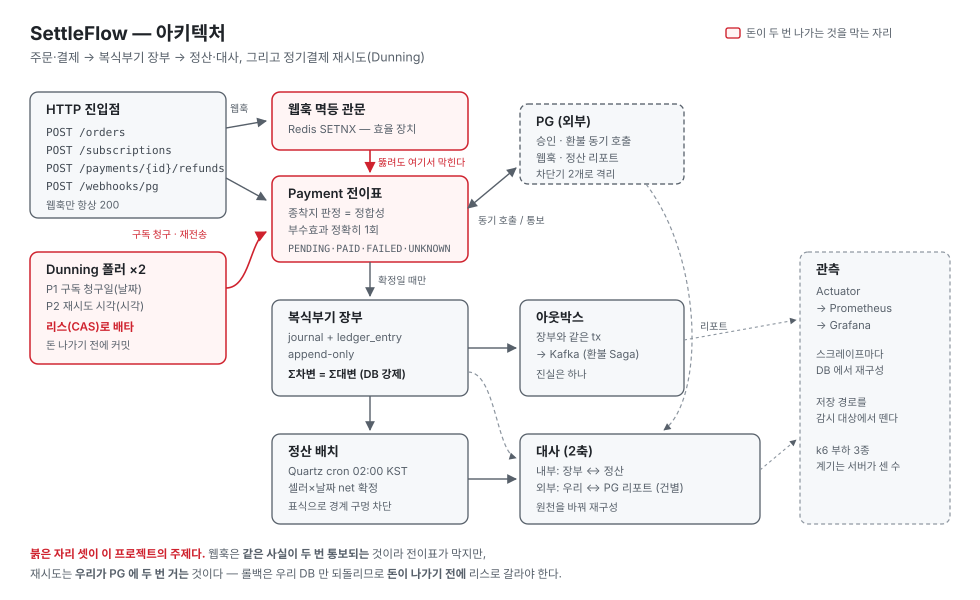
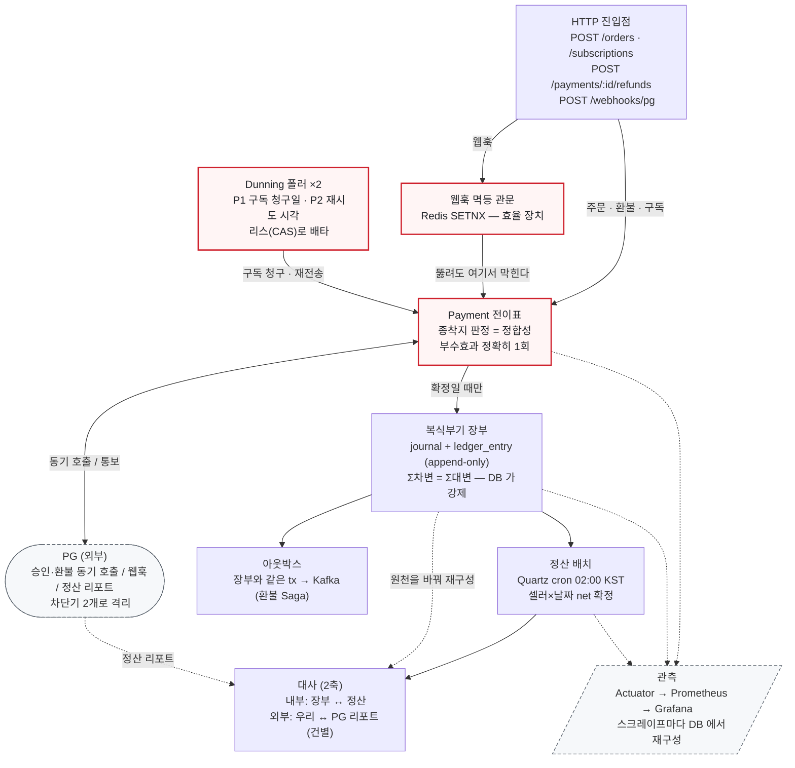

# SettleFlow

이커머스 결제·정산 플랫폼. **주문 → 재고 차감 → 결제 → 웹훅 수신**의 한 흐름을, 실패·중복·경합이 실제로 일어나는 지점마다 정합성을 어떻게 지키는지에 초점을 맞춘 프로젝트다.

주제 한 줄: **"돈과 재고는 두 번 세면 안 된다."** 웹훅은 중복으로 오고, 결제는 타임아웃 나고, 배치는 승인된 주문의 재고를 되돌리려 한다 — 이 세 자리에서 이중청구·이중판매가 나지 않도록 막는 게 이 프로젝트다.

> ~~⚠️ 진행 중(Week 1 완료 시점).~~ 5주 계획(Week 1~5) 완료. Week 6 은 계획 밖 보강(웹훅 서명 검증·시크릿 교체). 아래 "구현 현황" 참조.

---

## 스택

Java 21 · Spring Boot 4.1 · PostgreSQL · Redis · Flyway · JPA/Hibernate
· Kafka · resilience4j · Micrometer/Prometheus · Grafana · k6 · Testcontainers
~~(예정: Kafka, resilience4j, k6, Prometheus/Grafana — Week 2~4)~~ → Week 3~4 에 전부 들어갔다.

---

## 아키텍처 — 전체 구성



**붉은 자리 셋이 이 프로젝트의 주제다** — 돈이 두 번 나가는 것을 막는 층. 웹훅은 *같은 사실이 두 번 통보되는* 것이라 **전이표의 종착지 판정**이 막고(Redis SETNX 는 효율 장치라 뚫려도 된다), 재시도는 *우리가 PG 에 두 번 거는* 것이라 — 롤백은 우리 DB 만 되돌리므로 — **돈이 나가기 전에 리스(CAS)로** 갈라야 한다.

*(원본 `docs/img/architecture.svg`. PDF·슬라이드용 PNG 는 같은 폴더에 함께 둔다.)*

<details>
<summary><b>같은 그림의 Mermaid 버전</b> — 고칠 사람은 이쪽이 편하다</summary>

<br>

SVG 는 **좌표를 손으로 잡은 것**이라 PDF·슬라이드에 그대로 넣을 수 있고, Mermaid 는
**자동 배치**라 구조를 바꾸기 쉽다. 둘은 같은 내용이므로 **한쪽을 고치면 다른 쪽도 고쳐야 한다.**



</details>

## 아키텍처 — 한 주문이 흐르는 길

```
POST /orders
   │
   ▼
OrderService.place()
   │  tx1: 주문 생성 + 재고 원자적 차감 + 커밋      ← 여기서 끊는다
   │       (UPDATE product SET stock=stock-? WHERE stock>=?)
   ├──────── 트랜잭션 경계 ────────
   │
   ▼
PaymentService.pay()
   │  tx1': PENDING 결제 INSERT + 커밋            ← PG 부르기 전에 남긴다
   │  ─────  PG 동기 호출(트랜잭션 밖) ─────
   │  tx2 : 결과 반영 (승인→PAID / 거절→FAILED / 타임아웃→UNKNOWN)
   ▼
201 Created  { orderId, orderStatus: PAID, totalAmount }

        ── 나중에, 별도 경로 ──
POST /webhooks/pg   (PG 재전송, 중복 가능)
   │  SETNX(eventId) 실패 → 200 OK (문전박대)
   │  성공 → 전이 dispatch(낙관적 락) → 200 OK
```

### 핵심 설계 결정

| 문제 | 흔한 답 | 이 프로젝트의 선택 | 근거 |
|---|---|---|---|
| 재고 동시 차감 | Redis 분산 락 | **DB 원자적 조건부 UPDATE** | 재고 점유는 "순간"이라 락이 필요 없다. Redis를 얹으면 재고의 진실이 DB/Redis로 갈라져 대사와 충돌 |
| 웹훅 중복 | 멱등키(SETNX) 하나 | **SETNX(fast-path) + 상태가드·@Version(backbone) 두 겹** | SETNX를 빠져나온 중복(동기+웹훅 겹침, 다른 eventId 재승인)은 낙관적 락이 잡는다 |
| 결제 타임아웃 | FAILED 처리 | **UNKNOWN(정보의 부재)** | 타임아웃은 "실패"가 아니다. FAILED로 찍으면 실제 승인된 건에 이중청구 |
| 미결제 재고 복원 | 타이머 TTL | **PG 조회 후 복원(쓸이 배치)** | 타이머만 믿고 복원하면 늦게 승인된 결제의 재고를 되돌려 이중판매 |
| 트랜잭션 경계 | 전체 @Transactional | **PG 호출을 tx 밖으로** | tx 안에서 PG를 부르면 호출 실패 시 PENDING 행이 롤백돼, 나중 웹훅이 매칭할 행을 잃는다 |

각 결정의 상세 근거는 [`docs/`](docs/) 참조 (설계 → 선택지·트레이드오프 → 실측 순으로 기록).

---

## 실측 결과

> **원칙: 모든 수치는 실제 실행 결과.** 추정치·설계 의도를 결과로 적지 않는다.

### 로컬 e2e 관통 (2026-07-18 직접 실행)

`./gradlew bootRun`으로 앱을 띄우고 실제 HTTP 주문 1건을 관통시켜 확인:

```
POST /orders {"items":[{"productId":1,"quantity":2}]}
 → 201 Created {"orderStatus":"PAID","totalAmount":20000}

DB 대조:
 orders   : status=PAID  total_amount=20000
 payment  : status=PAID  amount=20000
 product  : stock 5 → 3        (원자적 차감 확인)
 order_item: unit_price=10000 quantity=2  (가격 스냅샷 확인)
```

`spring-boot-docker-compose`(developmentOnly)가 `bootRun` 시 compose를 자동 기동하고, 랜덤 호스트 포트(`5432→28830`)를 앱에 자동 주입 — `application.yaml`에 연결 설정 없이 부팅 성공(13.4초).

### 이전 세션 실측 (테스트로 검증, `docs/` 기록)

| 시나리오 | 결과 | 출처 |
|---|---|---|
| 재고 3, 동시 10명 주문 | 성공 3건 / 초과판매 0 | W1D3 |
| 같은 eventId 웹훅 20회 | 실제 처리 1건 | W1D4 |
| 다른 eventId 웹훅 20회 | 호출 20 / @Version=1 (backbone이 잡음) | W1D4 |
| 멱등 가드 제거(음성대조군) | TRANSITIONED 20 (빨간불 확인) | W1D4 |
| 환불 레이스(조건부 UPDATE) | 최종 잔액 정확 / 가드 제거 시 오염 | W1D2 |

전체 테스트 스위트: ~~**19건 통과** (2026-07-18)~~ → **40클래스 / 188건 통과** (failures=0, errors=0, skipped=0 — 2026-10-21 `./gradlew test --rerun-tasks` 재실행, `build/test-results` XML 합산). 아래 STAR 끝의 *"스위트 N건"* 은 각 주 마감 시점 값이다.

---

## 로컬 실행

**요구사항**: JDK 21, Docker (Desktop 실행 중)

웹훅 서명 시크릿을 **먼저** 넣어야 한다. 기본값을 일부러 안 뒀다 — 운영에서 환경변수를 빠뜨려도 앱이 떠서 *아무나 아는 시크릿*으로 서명을 받는 일을 막기 위해서다. 없으면 기동 실패.

```powershell
# PowerShell
$env:WEBHOOK_SECRET = "local-dev-secret"
./gradlew bootRun
```

```bash
# bash
WEBHOOK_SECRET=local-dev-secret ./gradlew bootRun
```

`bootRun`이 `compose.yaml`(postgres + redis)을 자동 기동하고 Flyway가 스키마를 만든다. 별도로 `docker compose up`을 칠 필요 없음.

**주문을 넣으려면 상품이 먼저 있어야 한다** (seed 데이터 없음):

```bash
docker exec -e PGPASSWORD=secret settleflow-postgres-1 psql -U myuser -d mydatabase -c \
  "INSERT INTO seller (name) VALUES ('셀러');
   INSERT INTO product (seller_id, name, price, stock) VALUES (1, '상품', 10000, 5);"

curl -X POST http://localhost:8080/orders \
  -H 'Content-Type: application/json' \
  -d '{"items":[{"productId":1,"quantity":2}]}'
```

> 결제 결과는 **총액**으로 결정된다(Mock PG). `총액 % 1000 == 111`→거절, `== 222`→타임아웃, 그 외→승인.
> 위 예시는 20000 → 승인(PAID).

**테스트**:
```bash
./gradlew test    # Testcontainers가 일회용 postgres/redis를 띄운다(Docker 필요)
```

---

## 구현 현황

- [x] **Week 1 — 주문·결제 코어 + 웹훅 멱등성**
  - 스키마(Flyway 6테이블), 엔티티, 재고 원자적 차감
  - Mock PG + 웹훅 수신 + SETNX 멱등 + 낙관적 락 backbone
  - `OrderService` 배선 + `POST /orders` + 로컬 e2e 관통 확인
- [x] **Week 2 — 이중장부(Ledger) + 부분환불**
  - `journal`+`ledger_entry` 모델(append-only) + 셀러별 자동 분개
  - `Σ차변==Σ대변` 을 앱 가드 + **지연 제약 트리거**로 이중 방어
  - 환불 요청 가드 + `refunded_amount` 파생 라벨(저장하지 않음)
  - 부분환불 **역분개** + 셀러별 안분 — 마지막 몫을 뺄셈으로 구해 균형을 구조화
- [x] **Week 3 — Kafka Saga + 정산 배치 + 대사(Reconciliation)**
  - 트랜잭셔널 **아웃박스** — 이벤트를 장부와 같은 트랜잭션에 써서 dual-write 소멸
  - 환불 **Saga** — 역분개를 PG 확인 뒤로 미뤄 **보상 트랜잭션을 구현하지 않고 없앴다**(취소할 장부 기록이 애초에 없다). 대신 *예약*(`reserved_refund_amount`)과 *기록*을 분리
  - 야간 **정산 배치** — 집계+upsert 를 `INSERT ... SELECT ... ON CONFLICT` 한 문장으로, 원천은 장부
  - **대사** 두 축(장부↔정산 / 우리↔PG 리포트) — 배치와 **다른 원천**으로 재계산해 동어반복 회피
  - **증발 구멍 상환** — 귀속 축(`created_at`)과 진행 축(`settlement_pending`)을 분리 + `REPEATABLE READ`
  - **불일치 자동 플래그** — 상태 UPDATE 대신 관측 누적(append-only) + 실행 기록
- [x] **Week 4 — 관측성 + 부하테스트(k6)**
  - PG 호출에 resilience4j **차단기** — 열린 동안은 *"안 보냈다"* 가 확실한 앎
  - Prometheus + Grafana — 정산 배치·대사 관측
  - k6 웹훅 중복 폭주 · 강제 종료 — 헤드라인을 HTTP 가 아니라 `journal` 증가분으로
- [x] **Week 5 — 정기결제 재시도(Dunning)**
  - 연체를 상태가 아니라 `billing_cycle` 행으로 — 되돌아오는 축(ABA)을 행으로 내림
  - Quartz 폐기 → 폴링 + **리스(CAS)** — 돈이 나가기 전에 배타성을 커밋
  - 결말 없는 시도는 새 청구가 아니라 **같은 키로 재전송**
- [x] **Week 6 — 웹훅 발신자 검증** *(5주 계획 밖)*
  - HMAC-SHA256 서명 검증을 **SETNX 앞에** — 401 은 멱등키를 안 남긴다
  - 시크릿 교체 — 신·구 키 병행 검증 + 키별 통과 카운터, 빈·공백 구 키는 "구 키 없음"
  - 바디를 `byte[]` 로 받아 **PG 가 서명한 바이트 그대로** 검증

---

## STAR — 웹훅 멱등성

**S(상황)**: PG 웹훅은 네트워크 재전송으로 **같은 사건이 여러 번** 도착한다. 결제 승인 웹훅이 20번 오면, 순진하게 처리하면 주문이 20번 PAID로 전이되고 후속 부수효과(정산·장부)가 20번 실행돼 이중청구가 난다.

**T(과제)**: 몇 번 도착하든 **정확히 한 번만** 처리하되, "이미 처리했다"를 에러가 아니라 정상으로 응답해 PG 재전송을 멈춰야 한다.

**A(행동)**: 방어를 **두 겹**으로 뒀다.
1. **fast-path** — Redis `SETNX(eventId)`를 전이보다 **먼저**. 두 번째 재전송은 PENDING을 읽어보기도 전에 200 OK로 문전박대(lost update 원천 차단).
2. **backbone** — SETNX를 빠져나온 중복(동기 승인+웹훅 겹침, 다른 eventId로 온 재승인)은 상태 가드 + JPA `@Version` 낙관적 락이 막는다. 진 쪽은 재조회 → 이미 종착지 → `IGNORED`.

성공 후 크래시로 200을 못 돌려줘도 재전송이 SETNX 실패로 멈추고(일은 커밋됨), 커밋 **전** 크래시로 키만 남으면 TTL 만료 + 쓸이 배치가 회수한다.

**R(결과)**: 같은 eventId 웹훅 **20회 → 실제 처리 1회**. 멱등 가드를 제거한 음성대조군에서는 `TRANSITIONED 20`이 관측돼(빨간불), 가드가 실제로 막고 있음을 반증으로 확인. *(W1D4 실측)*

> **Week 6 에 앞단이 하나 붙었다 — 서명 검증 → SETNX → 전이.** 이 STAR 의 멱등 처리는 *누가 보냈는지* 를 안 봤다. 검증을 SETNX **뒤에** 두면 위조 요청이 진짜 eventId 로 멱등키를 선점해 진짜 통보가 *"중복"* 으로 버려진다. 순서를 뒤집은 음성대조군에서 **3 red / 4 green**(예상은 1 red) — 셋 다 원인은 하나, *401 이 멱등키를 남긴다.* 정상 순서에선 401·400 이 SETNX 전에 반환돼 키가 안 남고, 그래서 PG 재전송이 막히지 않는다. 같은 이유로 응답 규약의 *"401 이면 재전송하지 말 것"* 을 정정했다 — 401 의 흔한 원인은 위조가 아니라 우리 쪽 시크릿 설정 실수다. *(W6D1 실측, [문서](docs/week6/W6D1_웹훅_서명검증.md))*

---

## STAR — 이중장부 불변식

**S(상황)**: 셀러 여럿이 입점한 이커머스에서 20,000원 결제 1건은 장부에서 **현금 20,000 차변 / 셀러 미지급금 19,000 + 수수료 1,000 대변**으로 쪼개진다. 이 장부가 정산의 진실원본이라, 한 줄이라도 어긋나면 셀러에게 줄 돈이 틀리고 Week 3 대사가 비교할 **기준 자체**가 무너진다.

**T(과제)**: `Σ차변 == Σ대변` 불변식을 **어떤 경로로도** 못 깨게 한다. 서비스 코드뿐 아니라 생 SQL·배치·미래의 다른 서비스가 `ledger_entry` 에 직접 INSERT 해도 지켜져야 한다.

**A(행동)**: 가드를 **두 층**에 뒀는데, 둘은 중복이 아니라 서로 다른 걸 잡는다.

1. **모델** — `journal`(사건) + `ledger_entry`(줄). 원인(payment/refund)이 `journal_id` 를 FK 로 가리키고, 장부는 **append-only**(지우개가 아니라 빨간 펜).
2. **앱 가드** — 서비스가 요율·반올림으로 쪼개고 `Journal.forPayment` 가 조립하며 `assertBalanced()`. **수수료만 반올림하고 미지급금은 빼서 구해** 두 줄의 합이 정의상 subtotal — 균형이 *구조적으로* 성립한다.
3. **DB 가드** — `CHECK` 로는 불가능하다. CHECK 는 자기 행 하나만 보는데 이 불변식은 **여러 줄을 합쳐야** 나온다. 즉시 트리거도 안 된다 — 3줄이 각각 INSERT 되므로 첫 줄(현금 20,000만)에서 대변 0 으로 **오판**한다. → `CONSTRAINT TRIGGER ... DEFERRABLE INITIALLY DEFERRED` 로 검사를 **커밋 시점**까지 미룬다.
4. **배선** — 분개는 승인 전이가 실제로 일어난 `TRANSITIONED` **1회에만** 실행(Week 1 의 멱등 backbone 재사용) → 중복 웹훅이 와도 이중계상이 없다.

**R(결과)** — 전부 실행 결과:

- 단일 셀러 결제 → `journal=1, entries=3`, 현금 **20,000** = 미지급금 **19,000** + 수수료 **1,000**, 차변==대변
- 다중 셀러(N=2) → `entries=5`(2N+1), 균형 유지
- **중복 승인 20회 → journal 1개** (이중계상 방어)
- 불균형 journal → INSERT 는 통과하고 **커밋에서 거부**. 실패 지점이 INSERT 가 아니라 커밋이라는 게 지연 트리거가 실제로 지연됐다는 증거
- **음성대조군 3건**: `assertBalanced` 에 불균형 입력 → 예외(영구 테스트로 고정) / 트리거 `DROP` → 불균형이 **그냥 커밋됨**(빨간불) / 멱등 가드 제거 → journal 이 **~21개**로 폭증
- **예상 못한 소득 — 두 가드가 서로 다른 걸 잡는다는 산 증거**: DB 제약을 넣자 기존 테스트의 *"올바른 조합"* fixture 가 깨졌다. 그 fixture 가 사실 **불균형**(20,000 vs 19,000)이었고 — **앱 가드는 통과시켰는데 DB 가드가 잡았다.** 이중방어가 관념이 아님이 사고로 증명된 자리.

**환불 방향으로도 성립하는가 (W2D5)**: 환불 역분개는 `SELLER_PAYABLE` 차변을 셀러별로 **안분**해야 하는데(스키마가 `seller_id` 를 NOT NULL 로 강제), 비례 배분은 반올림 때문에 그 자체로 균형을 보장하지 못한다 — `10,000/10,000` 에 `5,001` 을 환불하면 둘 다 반올림해 **5,002**, 둘 다 버리면 **5,000**. 그래서 **마지막 셀러 몫은 계산하지 않고 `amount − Σ앞의 것들` 로 구한다.** 합이 정의상 환불액이라 반올림 방식과 무관하게 균형이 성립한다 — 검사가 아니라 **구조**다.

- `.5` 경로 실측: 안분 **[2501, 2500]**, 차변합 **5,001** = 현금대변. 3셀러 `7,000/6,000/4,000` 에 `3,333` → **[1372, 1176, 785]** 합 **3,333**
- **부분환불 3회 → journal 4개(PAYMENT 1 + REFUND 3), 전체 합과 사건 단위 균형 모두 유지**
- 뺄셈을 제거한 음성대조군 → `차변=5002 대변=5001` / `차변=3332 대변=3333` 로 빨간불. **나머지 케이스는 그대로 통과** — 나눠떨어지는 fixture 만 있으면 이 결함이 아무 증상도 안 낸다는 증거
- 전액환불 시 미지급금 순액 **−1,000**(수수료 미환급 정책의 귀결, W3 정산에서 상계)

*(W2D1~D5 실측. 당시 스위트 **47건 0실패**.)*

---

## STAR — 정산 대사(Reconciliation)

**S(상황)**: 야간 배치가 하루치 장부를 셀러별로 집계해 정산액을 확정하고, 그 값이 **실제로 나가는 돈**이 된다. 그런데 정산 로직의 오류에는 고약한 비대칭이 있다 — **덜 주면 다음 날 전화가 오지만, 더 주면 아무도 말하지 않는다.** 과지급만 만드는 버그는 신고 경로 자체가 없어서, 테스트가 초록불이면 돈이 다 나간 뒤에도 모른다.

**T(과제)**: *"아무도 신고하지 않는 오류"* 를 스스로 찾아내는 장치를 만든다. 그리고 그 장치가 **감시 대상과 같이 틀리지 않아야** 한다.

**A(행동)**:

**1. 왜 DB 제약이 아니라 대사인가.** `settlement == SUM(ledger)` 는 지연 제약 트리거로 **강제할 수 있었다**(Week 2에서 이미 쓴 도구). 안 걸었다 — 이 관계는 *어긋날 수 있는* 관계라 막으면 방어가 아니라 **고장**이다(정산이 아예 안 써진다). **제약은 절대 어긋나면 안 되는 것에, 대사는 어긋날 수 있는 것에.** 그래서 `V8` 에는 CHECK 이 하나도 없다.

**2. 대사는 같은 SQL 을 재실행하지 않는다.** 배치가 쓴 집계 쿼리를 대사가 다시 돌리면 **동어반복**이다 — 배치가 틀리게 계산했으면 대사도 똑같이 틀리게 계산해서 **영원히 일치한다**(통장을 안 보고 가계부를 두 번 읽는 것). 그래서 **원천을 바꿨다**: 배치는 `ledger_entry` 를 합치고, 대사는 `payment`+`order_item` 을 **다시 쪼개** net 을 재구성한다.

**3. 축이 둘이고 각각 다른 걸 잡는다.** 내부(장부 ↔ 정산)는 *우리 계산이 틀렸다*, 외부(우리 ↔ PG 정산 리포트 CSV)는 *우리와 PG 가 다르다*. **외부 축은 건별**이다 — 합계로 맞추면 상쇄가 숨고(+5,000/−5,000), 애초에 잡으려는 게 금액이 아니라 **존재**다.

**4. 배치의 구멍을 닫고, 그걸 대사로 검증했다.** 하루를 시간으로 자르면 `journal.created_at`(persist 시점)과 가시성(커밋 시점)의 간격 때문에 **경계 직전에 찍히고 배치 뒤에 커밋된 줄이 증발**한다. 원인은 `WHERE` 한 줄이 서로 다른 두 질문에 동시에 답한 것 — *언제 귀속되는가*(멈춘 시계)와 *이미 셌는가*(움직이는 시계). **축을 분리**했다(`settlement_pending` + `REPEATABLE READ`). 뚫려 있을 때 대사가 그 구멍을 실제로 잡았고, 닫은 뒤 사라지는 것까지 확인했다.

**5. 불일치는 고치지 않고 기록한다.** 어긋남은 조사 대상이지 정정 대상이 아니다(무엇이 맞는지는 대사가 모른다). 상태를 UPDATE 하지 않고 **관측을 쌓는다**(append-only) — 값어치가 *"지금 어긋남"* 이 아니라 **"며칠째 안 메워짐"** 에 있기 때문이다. 대가로 *"안 나타남"* 이 **깨끗했다/안 봤다** 둘을 뜻하게 돼, 불일치 0건이어도 남는 **실행 기록**을 함께 뒀다.

**R(결과)** — 전부 실행 결과:

- **음성대조군이 이 STAR 의 핵심 증거다.** 집계 SQL 의 부호 하나(`ELSE -le.amount` → `ELSE le.amount`)를 제거:
  - 정산 배치 테스트 **2 red / 4 green**. **4개가 통과한 게 본체** — 그 데이터엔 `DEBIT` 줄이 없어 분기를 안 탄다. *초록불은 코드가 옳다는 뜻이 아니라 그 경로를 안 밟았다는 뜻*
  - 오차는 환불액의 **2배**(5,000 환불 → 10,000 어긋남). 빼야 할 걸 더했으므로
  - **부호가 항상 과지급 방향**(`DEBIT` 은 환불뿐이라 더하면 정산액이 언제나 실제보다 크다) = 신고가 안 들어오는 오류
  - **그리고 대사가 그걸 잡았다 — 2건, 차액 합 `+6,000 + 4,000 = 10,000`, 둘 다 양수.** 셀러별로 쪼개져도 총합이 2× 환불액으로 성립
- **의도적 불일치 3건 → 정확히 3건, 종류도 하나씩** (외부 축):
  `ONLY_IN_REPORT`(웹훅 유실, 리포트 33,000 / 내부 없음) · `AMOUNT_MISMATCH`(8,000 vs 9,000) · `ONLY_IN_INTERNAL`(환불 5,000 이 리포트에 없음)
  - **`ONLY_IN_REPORT` 가 외부 축의 상금** — 우리 안엔 기록 자체가 없어 **내부 축이 절대 못 잡는다**
- **증발 구멍**: 뚫려 있을 때 대사가 `AMOUNT_MISMATCH[정산=9,500 재구성=19,000]` 로 잡았고, 배치 재실행 후 **0건**. 축 분리 후에는 늦게 커밋된 줄이 **제 날짜로** 주워진다(1차 9,500 → 2차 19,000, 정산 행은 여전히 1개)
- **집계와 표식 삭제가 같은 스냅샷을 본다**: 배치 트랜잭션 도중 다른 커넥션이 커밋 → `살아남은 표식=1`, `배치직후=9,500`(집계에 안 들어감). **둘이 짝이 맞는 게 핵심** — 한쪽만 일어나면 그게 증발이다
- **자동 플래그**: 불일치 0건이어도 실행 기록 1행 / 해소 후 최신 실행은 깨끗해지되 **옛 관측 1건은 그대로 남는다**(append-only) / 정산을 **한 번도 안 부른** 날짜를 최근 창이 스스로 찾아내 `MISSING_IN_SETTLEMENT` 로 표시

**대사가 스스로 눈감지 않게 한 것 (설계상 제일 미묘했던 지점)**: 대사 대상 날짜를 *"정산이 방금 돈 날짜"* 로만 정하면, 정산 대상을 만드는 트리거가 죽었을 때 **정산도 0건 · 대사도 볼 게 없음 → 불일치 0건 = 초록불**이 된다. 모든 장부가 조용히 증발하는 동안. 그래서 날짜 출처를 셋으로 뒀다 — 정산이 돈 날짜 / **미해소 불일치가 있는 날짜**(해소될 때까지 스스로 살아남는다) / **최근 7일**(정산이 뭘 하든 무조건 본다). *금액을 어떻게 계산하는가* 는 독립으로 만들었는데 **무엇을 볼 것인가** 는 감시 대상이 정하고 있던 자리다.

**정직한 한계**: 외부 축의 **기준선 0건은 증명이 아니다** — Mock 리포트를 우리 DB 에서 만들므로 동어반복이고, 값은 *심은 불일치를 잡느냐* 에만 있다. 날짜 경계와 환불 안분 규칙은 **의도적으로 배치와 공유**한다(다르게 쓰면 반올림이 어긋나 정상 상태에서도 매일 1원씩 거짓 경보) — 그 둘이 틀리면 대사도 같이 틀린다.

**인덱스 순서도 재봤다**: 12,000행(300일×40셀러)에서 대사가 타는 *"특정 날짜의 전 셀러"* 조회는 `uq_settlement_date_seller` 를 **`Sort` 노드 없이** 탄다(0.045ms) — 복합 인덱스를 `(날짜, 셀러)` 순으로 둔 값어치가 여기서 나온다. 반대로 셀러 단독 조회는 leftmost prefix 가 아니라 그 UNIQUE 를 **못 타고**, 따로 판 인덱스를 지우면 `Seq Scan` 으로 떨어져 **12,000행 중 11,700행을 버린다.**

> ⚠️ **이 문장에는 전제가 하나 붙는다(W4D5 에 발각).** `Sort` 가 붙지 않는 건 플래너가 순서를 보존하는 `Index Scan` 을 고를 때이고, 그 선택은 인덱스 컬럼 순서가 아니라 **힙의 물리적 배치**(`pg_stats.correlation`)가 정한다. 같은 커밋에서 배치가 뒤집히자 같은 쿼리가 `Bitmap Heap Scan` + `Sort` 로 갔다(date corr **1.0000 → 0.0283**, 같은 날짜 40행이 1블록 → **40블록**). 프로덕션 배치는 하루치씩 넣으므로(`CAST(:date AS date)` 한 값 + `GROUP BY seller_id`) 실제 힙은 날짜순으로 쌓이고 전제가 성립한다. **다만 재실행 덮어쓰기(`ON CONFLICT DO UPDATE`)는 새 튜플 버전을 다른 자리에 쓰므로 재실행이 쌓이면 이 전제가 약해질 수 있다 — 그건 아직 안 쟀다.** 그래서 테스트는 `Sort` 를 단언하기 전에 **전제를 먼저 단언**한다.

*(W3D3~D5 실측. 당시 스위트 **92건 0실패**.)*

---

## STAR — 부하테스트(웹훅 중복 폭주 · 강제 종료)

**S(상황)**: Week 1 에서 만든 웹훅 멱등성은 이미 테스트로 증명돼 있었다 — 같은 eventId 20개 동시 → 처리 1회. 그러면 **1,000 VU 로 같은 것을 재는 건 동어반복**이다(Week 3 대사에서 세운 기준: 같은 계산을 두 번 하면 영원히 일치한다). 부하가 새로 가져오는 게 하나 있다면 **자원**이다. 그런데 자원이 터지는 것 자체는 성능 정보지 정합성엔 아무 말도 안 한다 — 값은 *"터진 상태에서도 명제가 유지되는가"* 에 있다.

**T(과제)**: ① 방어가 규모에서도 유지되는지 **수치화**한다 ② 무너질 때 **무엇이 먼저** 무너지는지 본다 ③ 그리고 그 수치가 **부하 발생기의 자기 보고여선 안 된다**.

**A(행동)**:

**1. 조용한 유실의 사슬을 코드로 따라갔다.** 웹훅 처리는 ①SETNX → ②DB 전이 → ③실패 시 키 삭제 순이다. ②가 실패하고 ③도 실패하면 **키가 남고**, PG 재전송이 ①에 막혀 **200 을 받고 재전송을 멈춘다** → payment 은 `UNKNOWN` 인 채 남고 **그 뒤로 어디에도 에러가 안 난다**. 잡아야 할 건 이것이었다.

**2. 볼륨만으로는 그 구멍에 도달하지 못한다 — 예측이 실측에 뒤집혔다.** *"Redis 커넥션 풀이 터진다"* 를 재보니 `CLIENT LIST` 커넥션이 **1개**였다(Lettuce 단일 커넥션 멀티플렉싱) — **고갈될 풀이 없다.** Redis 를 내려도 도달 못 한다: ①이 맨 앞이라 먼저 막히고 **키가 안 생겨 안전한 쪽으로 닫힌다.** → **부하 중에 앱을 강제 종료**하는 쪽으로 방향이 갈렸다(javadoc 이 인정해둔 *"커밋 전 크래시로 키만 남는"* 경로). `taskkill /F` 여야 한다 — graceful 이면 in-flight 가 끝나 ③이 정상 실행돼 구멍이 안 열린다.

**3. 헤드라인을 HTTP 가 아니라 `journal` 로 잡았다.** 우리 웹훅은 중복에도 **200** 을 준다(non-2xx 를 주면 PG 가 몇 시간 재전송한다). 그래서 *"1,000 VU → 409 997건"* 형태가 **원리적으로 불가능**하고, 방어가 일했는지는 **HTTP 에 안 나타나고 DB 에만 나타난다.** `journal` 은 경로에 안 흔들린다(`UNKNOWN→PAID` 는 version=2 라 version 축은 경로 의존). 소유 관계가 없어(FK 방향이 `payment.journal_id → journal`) **기준선 델타**로 잰다.

**4. 분자를 부하 발생기에서 서버로 옮겼다.** `http_reqs` 는 발생기의 **자기 보고**이고 실제로 어긋났다(보냄 1,000 / 도달 965). 서버가 센 수를 쓰면 발생기가 몇 개를 흘렸든 분자가 안 흔들린다. **그리고 시나리오마다 출처가 갈렸다** — 서버 Counter 는 프로세스와 수명을 같이하므로 **강제 종료 시나리오에선 못 쓴다**(끝나는 순간 앱이 죽어 있고, 되살리면 0이다). 그쪽 분자는 **Redis 키 개수**다. 셋 다 k6 자기 보고가 아니다.

**5. 회로를 끄지 않았다.** 차단기는 프로덕션 동작이므로 **끄고 잰 수치는 우리 시스템의 수치가 아니다.** 대신 타임아웃 금액을 **30% 혼합**해 회로를 닫아뒀고, 비율을 **난수가 아니라 전역 이터레이션 번호**로 고정했다 — 난수면 20건 창에서 임계 초과 확률이 ~5% 라 실행마다 회로가 열렸다 말았다 하고, **재현 안 되는 부하는 근거가 못 된다.**

**6. 고아 수를 kill 순간 in-flight 와 나란히 놓았다.** 고아 수는 rate 로 조절되므로 **그 자체로는 값이 아니다.** 활성 요청 수(`http_server_requests_active_*`)를 200ms 간격으로 표집해 **종료 직전 표본**을 썼다.

**R(결과)** — 전부 실행 결과:

- **★ 서버가 받은 중복 웹훅 1,000건 → `journal` 증가 1.** payment PAID/version 2, outbox 1, ledger_entry 3, 멱등키 1
  - **919건에서도 `journal` 증가 1.** 헤드라인은 1,000 쪽이지만 919 도 싣는다 — 근거는 수치의 크기가 아니라 **명제가 도달 수에 안 흔들린다**는 추가 증거라서다
  - **두 독립 경로가 정확히 일치**: k6 성공 919 = 서버 델타 919, 1,000 = 1,000, 누적 **1,919** 로 산술이 닫힌다
- **관문(100% 거절 경로) 천장 ≈ 6,100 req/s.** VU 상한을 2.7배 풀고 목표를 1.5배 올렸는데 달성치는 **+9%** 에서 멈추고 지연만 52 → 191ms — 포화의 정의
  - **435,150건 전부 HTTP 200. 5xx 0건, 앱 예외 0건.** 포화가 **에러가 아니라 지연**으로 나타났다(p95 2.19 → 190.85ms)
  - `pg-approve`/`pg-refund` 회로 **CLOSED 유지** — PG 를 안 부르는 설계가 실제로 그렇게 작동
- **★ 고아는 시스템 고유값이 아니라 kill 순간 in-flight 의 함수다** — 세 점이 받친다:

  | | 종료 방식 | 종료 순간 활성 POST | 고아(`UNKNOWN`) |
  |---|---|---|---|
  | kill A | `taskkill /F` | **3** | **0** |
  | kill B | `taskkill /F` | **99** | **23** |
  | graceful 대조군 | `/actuator/shutdown` | **175** | **0** |

  - 세 회차 모두 종료 시점 회로 **CLOSED·창 6/14(30%)·FAILED 0** 이라 **23은 kill 때문**이라고 말할 수 있다. 산술도 닫힌다(2,863 + 23 = 2,886)
  - **in-flight 가 더 많은 순간(175 vs 99)에 0** 이 나왔으므로 graceful 대조는 **약해지는 게 아니라 강해지는 방향**
  - `webhook_sent − 키` (B 10건 / graceful 59건)는 **SETNX 에 닿기도 전에 죽은 요청 = 고아가 아니다** — 키가 없으니 PG 재전송이 정상 처리된다(안전한 쪽으로 닫힘)
- **실제 전이를 밟는 전체 경로(주문+웹훅) 용량 ≈ 90 it/s.** 관문의 6,100 과 **자릿수가 다르다** — 둘을 같은 수치로 읽으면 안 된다
- **부하 시나리오는 앱 재기동으로 격리해야 한다**(이 주에 도출한 절차 규칙): 회로 창은 시나리오가 아니라 **앱 생애**의 상태라, 앞 시나리오의 PG 타임아웃 2건이 다음 시나리오의 회로를 열었다. 앱을 재기동해 창을 비우고 **같은 탐침을 재실행하니 CLOSED 유지**(4/16=20%), FAILED +0 → **이월된 실패가 필요조건**이었음이 갈렸다

**측정 도구가 세 번 틀렸다 — 이 STAR 의 특이한 소득**: 부하 쪽에서 어긋난 것은 대체로 감시 대상이 아니라 **재는 쪽**이었다.
1. **대조군이 설계 오류 둘을 잡았다.** 앱을 **안 죽이고** 돌렸는데 고아가 0이 아니라 **44건** — 모든 주문에 타임아웃 금액을 써서 회로가 10건 만에 열리고 이후 44건이 PG 에 닿지도 않은 채 FAILED 였다(= 셋업 경로가 처음 10건에서만 성립). 그리고 고아를 `!= PAID` 로 셌는데 **FAILED 는 정당한 종착지**였다. 수리 후 재실행 **키 100 / PAID 100 / FAILED 0 / 고아 0** — **0이 나와야 할 자리에서 0이 나왔으므로** 본 실행의 23을 kill 탓이라 말할 수 있다
2. **스크립트가 적어둔 판별 기준이 틀렸다.** *"`dropped_iterations > 0` = 클라이언트 한계"* 라고 주석에 있었는데, 상한을 풀자 dropped 만 7,336 → 2,885 로 줄고 **처리량은 안 늘었다** = 서버 포화의 파생 결과였다. 소켓 압력을 고정하려 넣은 장치가 **서버 신호를 클라이언트 신호처럼 보이게** 만들었다
3. **운영점이 오염된 값이었다.** 회로가 열려 주문이 PG 를 안 거치던 404ms 를 "톰캣 스레드 포화점"으로 읽었는데, 닫힌 상태의 실제 지연은 **4.18s**(p95 5.51s)였다

**정직한 한계**:
- **6,100 req/s 는 관문 거절 경로의 처리율**이고 결제 처리량이 아니다(위 90 it/s)
- **고아 23건은 이 시스템의 고유값이 아니다** — 두 점으로 비례를 증명하진 못했다
- 웹훅 in-flight 비중 **46% 는 추정**이다(활성 카운터에 uri 태그가 없어 절반 가정이 들어갔다)
- **graceful 대조군은 동일 조건 재현이 아니다**(175 vs 99). 방향이 보수적이라 결론은 서지만, 같은 in-flight 에서의 대조는 아직 없다
- **`server.shutdown=graceful` 은 대가를 재고 켰다(W4D5).** 같은 종료 경로(`/actuator/shutdown`)에 이 설정만 바꿔 비교했다 — 재시도 진행 중 `2,190 → 2,255ms`(+65ms), 포화 부하(RATE=300)에서 `immediate 8,963·8,757` vs `graceful 9,674·8,001`. **조건 내부 편차(1.7초)가 조건 사이 차이보다 커서 "얼마나 더 걸린다"를 말할 수 없다** — 말할 수 있는 건 대가가 노이즈보다 작다는 것이고, 종료 시간은 설정이 아니라 **부하가 지배**한다(무부하 2.2초 → 포화 8~9초, `immediate` 도 같다). ⚠️ 표본이 조건당 2회이고, `timeout-per-shutdown-phase`(30초) 상한 구간은 안 쟀다
- **포화 구간에서 관측이 굶었다** — 폴러의 `/actuator/prometheus` 호출이 **12표본 연속 실패**했다(1초 타임아웃 초과). **재려는 값이 가장 큰 구간에서 계기가 눈을 감는다**
- 부하는 **로컬 단일 머신**이다(클라이언트·서버·DB·Redis·Kafka 가 CPU 를 나눠 쓴다)
- **완전 동시가 아니다** — k6 에 배리어가 없다. `PaymentFlowTest` 의 `CyclicBarrier` 20개와는 성질이 다르다(테스트는 좁은 창의 경합을, k6 는 규모를 본다)

*(W4D3~D5 실측. 부하 실행 중 **프로덕션 코드는 한 줄도 안 바뀌었다** — `application.yaml` 두 줄을 graceful 대조군용으로 열었다 되돌렸다. 당시 스위트 **104건 0실패**.)*

---

## STAR — 정기결제 재시도(Dunning)

**S(상황)**: 구독 결제는 **실패가 정상 경로의 일부**다. 한도 초과·잔액 부족은 며칠 뒤면 풀리므로 실패를 종착지로 두면 멀쩡한 고객을 잃는다. 그래서 재시도가 필요한데, **재시도는 이중 청구의 온상**이다 — 그리고 이중 청구는 Week 1 의 웹훅 중복과 성질이 다르다. 웹훅은 *같은 사실이 두 번 통보되는* 것이라 우리 DB 안에서 막을 수 있지만, 재시도는 **우리가 PG 에 두 번 거는** 것이라 막지 못하면 **돈이 실제로 두 번 나간다.**

**T(과제)**: ① 실패한 구독료를 자동으로 다시 걸되 ② **동시에 여러 트리거가 발생해도 중복 청구 0건**임을 수치로 증명하고 ③ 그 수치가 **우리 코드의 자기 보고여선 안 된다**.

**A(행동)**:

**1. 계획서의 상태머신을 폐기하고 되돌아오는 축을 행으로 내렸다.** 계획서는 `ACTIVE → PAST_DUE → CANCELED` 였는데, 연체가 풀리면 `PAST_DUE → ACTIVE` 로 **돌아온다**. 되돌아오는 축은 **ABA** 를 만들고, 그러면 *"이 사건을 이미 반영했나"* 를 상태로 답할 수 없어 **멱등 backbone 이 죽는다**(Week 1 전이표가 종착지 판정으로 서 있는 구조 전체가 무너진다). 그래서 **주기를 `billing_cycle` 행으로 내리고** 구독에는 단방향 축(`ACTIVE → CANCELED`)만 남겼다. 연체는 상태가 아니라 **미납 주기 수의 함수**(파생 라벨)다.

**2. Quartz 를 근거를 갖고 폐기하고 폴링 + 리스(CAS)를 골랐다.** 기술결정서의 두 근거 중 *"재시작해도 예약 유지"* 는 `billing_cycle.next_retry_at` 이 **행에 있는 사실**이라 이미 충족돼 있었다. 남은 근거를 위해 Quartz 를 얹으면 *"다음 시도는 언제인가"* 의 원천이 **주기 행과 QRTZ 트리거 둘**이 된다 — **시계가 둘이 되는 대가가 더 크다.** 물증은 스키마에 있었다: 스키마에 이미 깔린 부분 인덱스 둘이 **전부 폴링 조회용**이라, Quartz 를 골랐다면 둘 다 죽은 인덱스가 된다.

**3. ★ 낙관적 락이 여기서 안 듣는 이유는 락이 약해서가 아니라 순서가 뒤집혀서다.** 인스턴스 둘이 같은 주기를 집으면 **둘 다 PG 를 부르고**, 커밋 시점에 `@Version` 이 하나를 롤백시켜도 **나간 돈은 안 돌아온다 — 롤백은 우리 DB 만 되돌린다.** Week 1 의 웹훅 처리는 [판정 → 부수효과]라 락이 편했는데 폴링은 **[부수효과 → 판정]**이다. 그래서 배타성을 **집는 단계**로 옮겼다: 돈이 나가기 전에 **커밋되는 사실**을 하나 만든다(`next_billing_date` 를 미리 밀고 커밋 — 진 인스턴스는 `WHERE ... = :expected` 가 0행을 잡고 물러난다). **PG 멱등키로도 못 막는다** — 시도마다 키가 새로 발급되므로 두 인스턴스가 만든 두 시도는 PG 입장에서 **서로 다른 정당한 청구**다.

**4. 상한을 값으로 적지 않았다.** `maxAttempts = 3` 을 두면 `[1일, 3일, 7일]` 과 **항상 같아야 하는 값의 복제**가 된다(이 프로젝트에서 세 번 기각한 모양). **포기는 목록에 다음 칸이 없다는 사실**이지 따로 적는 수가 아니다 — 목록을 `[1,3,7,14]` 로 늘리면 상한이 저절로 따라온다.

**5. ★ 계기를 두 번 갈아탔다 — 이 STAR 의 방법론적 알맹이.**

| | 계기 | 왜 버렸나 |
|---|---|---|
| 처음 | `payment` **행 수** | *"한 시도 = 한 PG 호출"* 이 **검증 대상 코드 자신의 성질**이다. 행을 세고 "청구 횟수"라 부르면 재는 자와 재이는 것이 경로를 공유한다 |
| 다음 | **PG 호출 수**(Mockito / `pg-approve` 카운터) | 우리 코드 밖의 계기라 옳지만, **재전송과 중복 청구를 못 가른다**(재전송은 호출을 늘리고 키를 안 늘린다) |
| 지금 | ★ **서로 다른 `merchant_payment_id` 개수**(헤드라인) + PG 호출 수(교차검증) | 키 = *"PG 가 별개 청구로 볼 것"* 의 수. 둘의 차이에 이름이 있다 → `PG 호출 − 키 = 재전송 횟수` |

**6. ★ 멱등키가 이 문제를 못 겨눈다는 결론을 하루 만에 한 칸 좁혔다.** 크래시 후 재집기를 재현하니 **PG approve 3회 · 서로 다른 키 3개**가 나왔다 — 멱등키는 정상인데 **돈은 두 번**이다. 여기서 *"키를 주기 단위로 올리면 시도 층이 무너진다"* → *"한쪽을 고치면 다른 쪽이 깨진다"* 로 닫았는데, **선택지가 둘이 아니라 셋이었다**: 새 시도를 만들지도, 키를 올리지도 않고 **그 시도를 다시 보낸다.** 결말이 안 난 시도(`PENDING`·`UNKNOWN`)는 *"새 청구가 필요하다"* 가 아니라 **"답을 아직 못 들었다"** 이고, 되돌릴 근거가 없으면(무응답 환불을 `UNKNOWN` 으로 두는 규칙) **새로 낼 근거도 없다.** 재전송은 행을 안 늘리고 상한도 안 흔들어 **시도 층을 깨지 않는다** — 그리고 그게 멱등키가 원래 겨누던 것이다.

**7. 재전송에는 상한을 안 걸었다.** 상한은 *"청구를 몇 번 걸었나"* 를 세는데 재전송은 청구를 안 늘린다. **무한 질의는 무한 청구와 다르다**(매번 돈이 느는 것과 같은 걸 다시 묻는 것). 대신 멈추는 장치가 없으므로 **드러나는 장치**를 뒀다 — 6시간 넘은 미결 시도를 세어 경고한다.

**8. 부하 시나리오에서 k6 를 부하 발생기로 쓰지 않았다.** Dunning 은 **폴링으로 스스로 깨어난다** — 밖에서 쏠 곳이 없고, 트리거를 HTTP 로 열면 **프로덕션에 없는 모양**(톰캣 스레드풀이 폴러를 병렬 호출)을 재게 된다. 그래서 동시성의 출처를 **앱 인스턴스 다중화**로 잡고, k6 는 **시딩·판정** 쪽으로 물러났다. 리스가 겨누는 것이 정확히 다중 인스턴스이므로 논증이 필요 없다.

**R(결과)** — 전부 실행 결과:

- **★ 헤드라인: 인스턴스 3개 · 폴링 1초 · 구독 500개가 같은 날짜에 동시 도래 → 중복 청구 0건.**

  | 계기 | 값 |
  |---|---|
  | 서로 다른 `merchant_payment_id` | **500** (구독·주기·시도와 정확히 일치) |
  | 한 주기가 키를 2개 이상 받은 것 | **0건** |
  | `cycle_no` 최대 / 구독당 주기 2개 이상 | **1 / 0건** — P1 CAS 가 시계를 한 번만 밀었다 |
  | PG 실호출 | :8091 **160** · :8092 **169** · :8093 **171** → **합 500** |
  | 회로 | **3개 전부 CLOSED** |

  - **세 인스턴스가 500건을 거의 3등분한 것이 경합의 직접 증거다.** 셋 다 같은 조회 목록을 같은 순서로 훑었고, 어느 행이 누구 것이 되는지는 CAS 가 갈랐다
  - **대조군(인스턴스 1개)에서 0 이 나와야 할 자리에서 0** — 위반 0 · 키 500 · `PAID` 350/`PENDING` 150(설계한 타임아웃 30%와 일치). 그래서 3 인스턴스 수치를 다중화 탓으로 돌릴 수 있다
- **★ 리스를 빼면 무질서가 아니라 *질서 있는 열 번*이 나간다**(음성대조군 실측): CAS 조건 한 줄을 제거하고 동시 폴링 10 → **서로 다른 키 10 · PG 호출 19 · 주기 10**. `uq_billing_cycle_subscription_no` 는 **한 건도 못 걸렀다** — `claimBillingDate` 가 같은 구독 행을 UPDATE 하므로 **행 락이 이미 직렬화**하고, 각자 자기 차례에 `max+1` 을 새로 계산해 번호가 안 겹친다. **직렬화는 공짜로 얻고 있었고 CAS 는 그 줄에서 승자를 가릴 뿐이다.**
  - 그리고 `19 − 10 = 9` 가 **재전송 횟수**다(뒤 스레드가 앞 스레드의 `PENDING` 주기를 회수하며 같은 키로 다시 보냈다) — 위 항등식이 실데이터에서 성립한 자리
- **이중 청구가 실재했고, 재전송이 닫았다**: 크래시 후 재집기 → **PG approve 3회 · 키 3개** → 재전송 도입 후 같은 시나리오 **키 2개**(호출은 그대로 3회 — 줄어드는 건 *PG 가 별개 청구로 볼 것*의 개수다). 멱등 PG 스텁 위에서는 **요청 3회 · 과금 2회**
- **차단기가 미결 시도를 `FAILED` 로 확정하고 있었다**: Week 4 의 *"안 보냈으니 확실한 앎"* 은 **새 시도에만** 참이다 — **재전송이 안 나간 건 원래 요청이 어떻게 됐는지 아무것도 안 알려준다.** 여기서 실패로 확정하면 *"모른다"* 를 잃고 그 시도가 다시 물어볼 대상에서 빠진다
- **★ 회로가 열린 실행조차 숫자가 닫힌다**(첫 3 인스턴스 실행, 타임아웃 30%): **PG 실호출 393 + 미발송 107 = 시도 500**, 그리고 **주기 `FAILED` 107 = 미발송 107.** 유실이 아니라 Week 4 의 결정이 프로덕션에서 작동한 것이고, **그 판단을 단위 테스트 밖에서 처음 관측했다**
- **음성대조군 12회 본인 실행 · 예측 12/12 적중**(프로젝트 최다). 그중 한 쌍이 설계 판단을 갈랐다 — 집기 직전 백스톱을 **지워도 red 0**(아무도 안 지킨다)인데 **재전송 분기를 지우면 그 자리에서 1회 발화**한다. 죽은 코드가 아니라 **그 분기에 딸린 안전장치**이고, 지키는 대상이 *시나리오*가 아니라 **전제의 회귀**라 테스트가 아니라 **주석**으로 못 박았다

**★ 이 주의 특이한 소득 — "전제가 만료됐다"가 사흘 연속 났다**: 셋 다 버그를 넣은 게 아니라, **새 호출부·새 분기가 들어오면서 기존 판단의 정의역이 조용히 좁아진 것**이다.

| | 어제까지 참이던 것 | 무엇이 정의역을 뺏었나 |
|---|---|---|
| 1일차 | 실패 수 계산의 `+1` | **웹훅이 두 번째 호출부**가 됐다(이미 `UNKNOWN` 인 시도에 도착한다) |
| 2일차 | 차단기 개방 = *"확실한 앎"* | **재전송이 생겼다** |
| 3일차 | 백스톱 = *"마지막 벽"* | **재전송 분기가 그 앞에 놓였다** |

셋 다 **같은 주에 내가 만든 변경**이 원인이다. Week 4 가 *"검증 없이 적힌 단정이 다음 세션의 전제가 된다"* 였다면, 여기서는 **검증했고 참이었던 문장**이 문제였다 — 참이었던 문장은 의심 대상이 안 되기 때문에 **더 오래 산다.**

**정직한 한계**:
- **★ *"PG 가 같은 키에 한 번만 과금한다"* 는 검증 불가**다 — 우리 계기 밖의 외부 계약이다. 그래서 테스트 파일을 절로 갈라 *"우리가 보증하는 것"*(키 개수)과 *"PG 에 기대는 것"*(스텁 위의 `[실측·가정]`)을 **파일 구조로** 분리했다
- **부하 실행에서 재전송 경로는 안 밟혔다** — `PENDING` 50건의 회수는 다음 청구일(30일 뒤)이라, 항등식을 **`= 0` 으로만 확인**했고 0 이 아닌 값으로는 부하에서 못 봤다(단위 테스트에서만 9)
- **P2(재시도 시각) 레이스는 약한 통과다** — 부하는 P1 만 겨눴다. `next_retry_at` 은 흩어져 있어 한 시각 도래분이 적다
- **CAS 패자 수를 세는 계기가 없다** — *"충돌이 실제로 일어났나"* 를 직접 못 본다(분배 160/169/171 이 대리 지표)
- **차단기 OPEN 시 재시도 간격을 소모하지 않고 연기하는 것은 미구현** — 회로가 열린 동안 1일→3일→7일이 그냥 소모된다
- 부하는 **로컬 단일 머신**에 인스턴스 3개다
- **인덱스로 고정한 타임아웃 비율은 소비자가 하나일 때만 성립한다**(이번에 발각): 인스턴스가 여럿이면 각자 부분집합을 받아 앞 10건 창에서 회로가 열릴 수 있다 — 30%에서 한 인스턴스가 열려 **10%로 낮춰야** 셋 다 닫힌 채 끝났다

*(W5D1~D5 + 마무리 실측. 당시 스위트 **171건 0실패**.)*

---

## 문서

설계 근거·실측 로그는 [`docs/`](docs/)에 주별 폴더로 기록. 주 무관 인덱스(5주 계획·체크리스트·기술결정)는 `docs/` 루트, daily 로그는 `docs/weekN/`:
- [`week1/W1D1_결제_도메인_설계.md`](docs/week1/W1D1_결제_도메인_설계.md) — 전이표, Order↔Payment 1:N
- [`week1/W1D3_스키마_확정.md`](docs/week1/W1D3_스키마_확정.md) — 스키마·엔티티, Redis 락 폐기 근거
- [`week1/W1D4_웹훅_멱등.md`](docs/week1/W1D4_웹훅_멱등.md) — SETNX/backbone 두 겹
- [`week1/W1D5_배선.md`](docs/week1/W1D5_배선.md) — 전체 배선, 트랜잭션 경계
- [`week2/W2D1_이중장부_설계.md`](docs/week2/W2D1_이중장부_설계.md) — journal+ledger_entry 모델, append-only
- [`week2/W2D2_자동분개_셀러별장부.md`](docs/week2/W2D2_자동분개_셀러별장부.md) — 셀러별 분개, 반올림으로 균형을 구조화
- [`week2/W2D3_불변식_DB제약.md`](docs/week2/W2D3_불변식_DB제약.md) — CHECK 로 안 되는 이유, 지연 제약 트리거
- [`week2/W2D4_환불_가드_파생라벨.md`](docs/week2/W2D4_환불_가드_파생라벨.md) — 파생 vs 저장, 가드 분업, affected rows 를 판정으로
- [`week2/W2D5_역분개.md`](docs/week2/W2D5_역분개.md) — 환불 역분개, 셀러별 안분, 뺄셈으로 균형을 구조화
- [`week3/W3D1_이벤트_아웃박스.md`](docs/week3/W3D1_이벤트_아웃박스.md) — 트랜잭셔널 아웃박스, 진실 vs 전송 큐
- [`week3/W3D2_환불사가_보상.md`](docs/week3/W3D2_환불사가_보상.md) — 보상 트랜잭션을 소거한 근거, 예약 vs 기록
- [`week3/W3D3_정산배치.md`](docs/week3/W3D3_정산배치.md) — 저장을 채택한 기준, 덮어쓰기가 복구가 되는 이유, 커밋 가시성 구멍
- [`week3/W3D4_대사.md`](docs/week3/W3D4_대사.md) — 독립 원천, 두 축, 조인 키를 바꾼 이유
- [`week3/W3D5_스냅샷_불일치플래그.md`](docs/week3/W3D5_스냅샷_불일치플래그.md) — 귀속/진행 축 분리, 관측 누적, 날짜 출처 셋
- [`week4/W4D1_PG차단기.md`](docs/week4/W4D1_PG차단기.md) — resilience4j CircuitBreaker
- [`week4/W4D2_관측성.md`](docs/week4/W4D2_관측성.md) — Prometheus + Grafana, 정산 배치·대사 관측
- [`week4/W4D3_k6_시나리오설계.md`](docs/week4/W4D3_k6_시나리오설계.md) — 웹훅 중복 폭주 · 결함 주입 설계
- [`week4/W4D4_k6실행_결과분석.md`](docs/week4/W4D4_k6실행_결과분석.md) — k6 본 실행 + 결과 분석
- [`week4/W4D5_회귀_안정화.md`](docs/week4/W4D5_회귀_안정화.md) — 전체 회귀 + 버그 픽스
- [`week5/W5D1_구독_상태머신.md`](docs/week5/W5D1_구독_상태머신.md) — 계획서 상태머신 폐기, 주기를 행으로
- [`week5/W5D2_재시도_스케줄러.md`](docs/week5/W5D2_재시도_스케줄러.md) — 폴링 + 리스(CAS), Quartz 폐기
- [`week5/W5D3_웹훅_라우팅과_멱등_반증.md`](docs/week5/W5D3_웹훅_라우팅과_멱등_반증.md) — 웹훅 라우팅, 멱등키 반증
- [`week5/W5D4_재전송으로_이중청구_창_닫기.md`](docs/week5/W5D4_재전송으로_이중청구_창_닫기.md) — 같은 키 재전송으로 이중 청구 창 닫기
- [`week5/W5D5_아무도_안_재던_자리.md`](docs/week5/W5D5_아무도_안_재던_자리.md) — 아무도 안 재던 자리 셋
- [`week6/W6D1_웹훅_서명검증.md`](docs/week6/W6D1_웹훅_서명검증.md) — 서명 검증을 멱등 처리 앞에, 401 규약 정정
- [`week6/W6D2_웹훅_시크릿교체.md`](docs/week6/W6D2_웹훅_시크릿교체.md) — 신·구 키 병행 검증, 공백 구 키, `byte[]` 전환
- 회고: [`W4`](docs/week4/W4_회고.md) · [`W5`](docs/week5/W5_회고.md) · [`W5 마무리`](docs/week5/W5_마무리.md)
